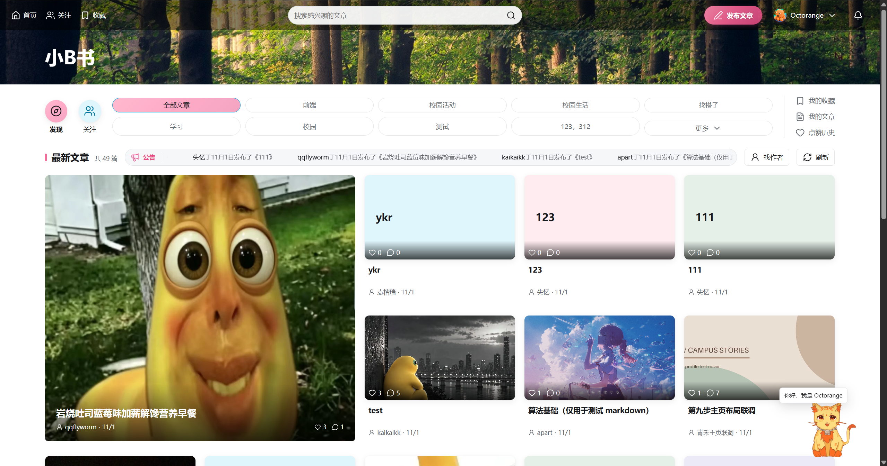

# 小B书（biliblog）

小B书是一个面向校园学习与生活的博客网站，用户可以阅读图文文章、分享自己的记录、参与评论，也可以关注作者或收藏感兴趣的内容

本项目选择前端大作业路线二，使用原生 HTML、CSS、JavaScript 和 Vite 开发，学校提供的后端负责保存账号、文章和互动数据



## 当前功能

| 模块 | 功能 |
| --- | --- |
| 账号 | 注册、登录、退出，显示当前用户，刷新后确认登录状态 |
| 首页 | 图文文章列表、关键词搜索、话题筛选、分页，以及文章发布公告 |
| 关注 | 在作者主页关注或取消关注，同步粉丝数；关注页按作者分行展示当前页文章 |
| 个人主页 | 查看作者资料、头像、封面、个人介绍、外部链接、文章列表和月份归档 |
| 资料设置 | 修改昵称、简介、主页短句、Markdown 个人介绍和外部链接，上传头像、上传或移除封面 |
| 阅读 | 点击卡片打开文章详情，通过文章链接直接访问或刷新 |
| 发布 | 填写标题、正文和话题，上传图片或选择本人素材，发布后打开文章 |
| 图片 | 本地预览、逐张上传、素材库分页，以及移出当前文章 |
| 互动 | 在文章详情中点赞、收藏及取消，查看我的收藏 |
| 评论 | 阅读主评论与一级回复，分页浏览，发表评论、回复主评论和删除自己的评论 |
| 通知 | 右上角铃铛显示未读数，按类型和已读状态筛选、分页、单条或全部已读，支持按账号保存在当前浏览器的“标记未读”；评论通知定位到目标评论，关注通知打开个人主页 |
| 删除 | 在“我的文章”中删除本人公开文章，操作前确认，完成后刷新列表 |

页面会显示加载状态、空列表和请求错误，发布与互动按钮会在请求期间限制重复操作

## 本地运行

建议使用 Node.js 24，项目依赖通过 npm 安装

在项目目录打开终端，依次运行：

```powershell
npm install
npm run dev
```

安装依赖后，用户也可以双击项目根目录的 `start.cmd`，脚本会在后台启动服务，确认首页可访问后打开浏览器；服务已运行时，脚本直接复用现有服务

启动后，浏览器访问 [小B书首页](http://127.0.0.1:5173/index.html)，手动启动服务时需要保持终端运行

项目使用固定的 `5173` 端口，Vite 会在端口占用时提示错误。浏览器应通过上面的 HTTP 地址访问页面

学校后端地址为 `https://dev.muyufly.com/api/v1`，访问者需要连接校园网络；代理软件应将 `dev.muyufly.com` 设为直连

### 构建与预览

```powershell
npm run build
npm run preview
```

Vite 将构建结果写入 `dist/`，预览服务同样使用 `5173` 端口，运行预览前需先结束开发服务

### 本机自动启动

`tools/start-dev.ps1` 负责后台启动 Vite，并检查已有服务是否提供小B书首页，日志保存在 `%LOCALAPPDATA%\biliblog`

登录 Windows 后自动启动需要在本机的“启动”文件夹中配置快捷方式，调用上述脚本；用户也可以双击 `start.cmd` 启动项目

## 使用步骤

1. 用户进入注册页创建账号，注册成功后页面自动进入首页；已有账号可以直接登录
2. 用户可以在首页搜索文章、选择话题，点击文章封面或标题阅读全文
3. 用户点击右上角“发布文章”，填写标题和正文；输入话题后按空格、回车或逗号添加，每篇最多 5 个，每个最多 20 个字符
4. 用户选择图片后，先点击“上传选中图片”，也可以从“已上传图片”中选择素材，再点击“发布文章”
5. 用户在文章详情底部点赞或收藏，再次点击相应按钮即可取消；用户可以从“我的收藏”查看收藏结果
6. 用户进入“我的文章”，点击本人文章下方的“删除”，核对确认框中的标题后完成删除
7. 用户在文章详情底部填写评论，或点击主评论下方的“回复”；用户可以展开回复列表，也可以确认删除自己的评论
8. 用户点击文章作者名进入个人主页，点击“关注”或“已关注”切换关注关系，再从首页“关注”查看文章；每位作者单独分组，文章多时在组内换行，翻页后按新一页的结果分组
9. 用户从账号菜单进入“我的主页”或“资料设置”，修改资料后保存，页面会跳转至个人主页
10. 用户点击导航最右侧的铃铛查看通知，选择消息类型和阅读状态；点击“查看”打开相关内容，也可以单独标记或全部标记已读

图片支持 JPEG、PNG 和 WebP，每张最大 5 MiB，每篇最多 9 张。上传图片在校园网络内公开可访问，用户应选择适合公开分享的内容

发布请求遇到网络中断时，页面会保留当前输入，并提示用户先核对“我的文章”。用户确认文章尚未创建后，可以允许再次提交

## 项目结构

```text
Blog/
├── start.cmd               双击启动服务并打开首页
├── index.html              首页与文章阅读窗口
├── login.html              登录页面
├── register.html           注册页面
├── publish.html            文章发布页面
├── profile.html            个人主页与关注操作
├── settings.html           个人资料设置
├── scripts/
│   ├── api.js              公共请求、文件表单与错误处理
│   ├── auth.js             登录凭证的保存、读取和清理
│   ├── account.js          注册和登录表单
│   ├── common.js           页面提示、等待状态和删除确认
│   ├── config.js           共享接口限制、分页参数和素材配置
│   ├── media.js            图片校验和本地预览
│   ├── motion.js           面板过渡、公告滚动和导航动效
│   ├── home.js             首页、关注分组、筛选、文章阅读与删除
│   ├── publish.js          发布表单、图片上传与素材选择
│   ├── profile.js          个人主页、月份归档与关注状态
│   ├── settings.js         资料编辑、头像与封面上传
│   ├── reactions.js        点赞、收藏与状态同步
│   ├── comments.js         评论列表、回复、分页和本人评论删除
│   ├── notifications.js    消息弹窗、筛选、未读数与已读操作
│   └── icons.js            公共图标
├── tools/
│   ├── check-style.mjs     JavaScript 语法风格和函数说明检查
│   ├── check-project.mjs   文件命名、引用和接口限制检查
│   └── start-dev.ps1       本机开发服务启动脚本
├── styles/
│   ├── navigation.css      Vite 提前注入的页面跳转声明
│   ├── common.css          基础页面与表单样式
│   ├── account.css         登录与注册页面样式
│   ├── home.css            首页、作者分组、阅读窗口与删除确认框
│   ├── comments.css        评论表单、主评论和一级回复样式
│   ├── publish.css         发布表单与素材库样式
│   ├── profile.css         个人主页样式
│   ├── settings.css        个人资料设置样式
│   ├── feedback.css        公共动效、提示与对话框反馈
│   ├── notifications.css   铃铛、消息列表与评论定位样式
│   └── tokens.css          统一颜色、字体和尺寸
├── assets/images/          项目图片素材
├── screenshots/            README 使用的页面截图
├── markdown-export/        本地课程教程，保留在开发电脑并由 Git 忽略
├── openapi.json            接口定义
├── design.md               页面设计规范
├── AGENTS.md               项目协作约定
├── vite.config.js          页面构建入口
├── package.json            依赖与运行命令
├── package-lock.json       依赖版本记录
├── .gitignore              Git 忽略规则
├── LICENSE                 项目许可文件
└── README.md               项目说明
```

## 数据如何流动

用户提交账号表单后，前端将账号信息发送给学校后端。后端验证成功后返回登录凭证，浏览器将凭证保存在当前网站的本地存储中，后续请求通过凭证确认用户身份

用户发布文章时，前端先上传图片，取得图片 ID，再将标题、正文、话题和图片 ID 一起交给后端。用户打开文章时，页面重新读取后端保存的内容

用户点击点赞或收藏后，页面使用后端返回的状态与数量更新按钮。用户删除文章后，页面重新查询文章列表，更新卡片和分页

用户关注作者后，页面使用后端返回的关注状态和粉丝数更新主页。关注页读取当前页文章，再按作者用户名分组；文章总数和分页仍以接口结果为准

## 代码阅读与性能

关键流程的中文注释说明了凭证校验、请求编号、草稿保留、结果核对和局部资料更新的原因，可从 `scripts/api.js`、`scripts/home.js`、`scripts/comments.js` 和 `scripts/publish.js` 开始阅读

- 同一账号同时读取本人身份时复用进行中的请求，完成后立即清理；不缓存身份结果，其他接口和写操作独立执行
- 关注文章通过用户名索引分组，保留作者首次出现顺序和组内文章顺序
- 素材选择直接更新本地按钮状态，不重新读取素材列表；图片上传完成后释放已不用的本地预览地址

## 检查结果与验收安排

- 修改代码后运行 `npm run check`，检查自维护脚本的语法风格、函数说明、模块与资源引用、文件命名及接口限制，再运行 `npm run build`
- 项目已通过 Vite 构建和 JavaScript 语法检查
- 公开阅读已通过真实接口检查，覆盖首页、搜索、话题筛选、文章详情、详情刷新和空列表
- 首页已检查 320、375、414、768、1280、1920px 六种宽度，布局随屏幕切换为 1～5 列
- 账号菜单、收藏分页、退出和请求失败恢复已通过模拟响应检查
- 关注操作已通过模拟接口检查，覆盖关注、取消、刷新恢复、重复点击、登录失效、账号切换和结果未知时的状态核对
- 关注页已检查作者分组、同名作者区分、分页、搜索、阅读互动、空列表与请求失败，以及 320～1920px 六种宽度
- 删除交互已通过模拟接口检查，覆盖本人操作入口、取消、确认、列表刷新和结果不明时的状态查询
- 评论已通过模拟接口检查，覆盖主评论和回复分页、发送、本人删除、删除占位、失败保留输入、登录失效、请求隔离及 320～1280px 布局；测试中的写操作均由模拟接口接管
- 真实公开接口已检查游客阅读主评论与回复，桌面和 375px 手机宽度的评论区截图已核对
- 本地启动脚本已检查首页访问和重复运行时的进程复用；登录 Windows 后自动启动按本机快捷方式配置
- 发布、上传、点赞和收藏已接入后端接口，接下来的验收会使用本人测试账号，重点核对操作结果与刷新后的状态

用户在同一个发布页面内重新登录时，输入和已选图片会继续保留；刷新或关闭页面后的内容恢复列入后续开发

## 后续计划

后续可以继续补充文章编辑、草稿保存、关注与粉丝名单、素材清理和模拟商铺，具体范围按作业进度安排

## 设计与素材来源

首页设计参考 [teriteri-client](https://github.com/xunlu129/teriteri-client) 的导航、分区和图文网格，页面颜色与组件规则统一记录在 `design.md` 中

项目使用 [Lucide](https://lucide.dev/) 图标，森林横幅来自 [Unsplash 图片](https://images.unsplash.com/photo-1441974231531-c6227db76b6e)，目前作为首页占位素材，后续可以替换为本人拍摄的校园照片

## AI 协作说明

本项目使用 AI Agent 辅助拆解需求、编写代码、排查错误和检查页面，开发者负责确定功能范围与设计方向，并通过实际操作验收结果

路线二的附加材料选择本人手写的代码理解与开发说明，开发者会结合项目代码和实际开发过程完成这份材料
