# 小B书（BiliBlog）

本项目采用**路线二：AI Agent 开发**，主要使用 HTML5、CSS3、JavaScript 和 Vite 完成前端

[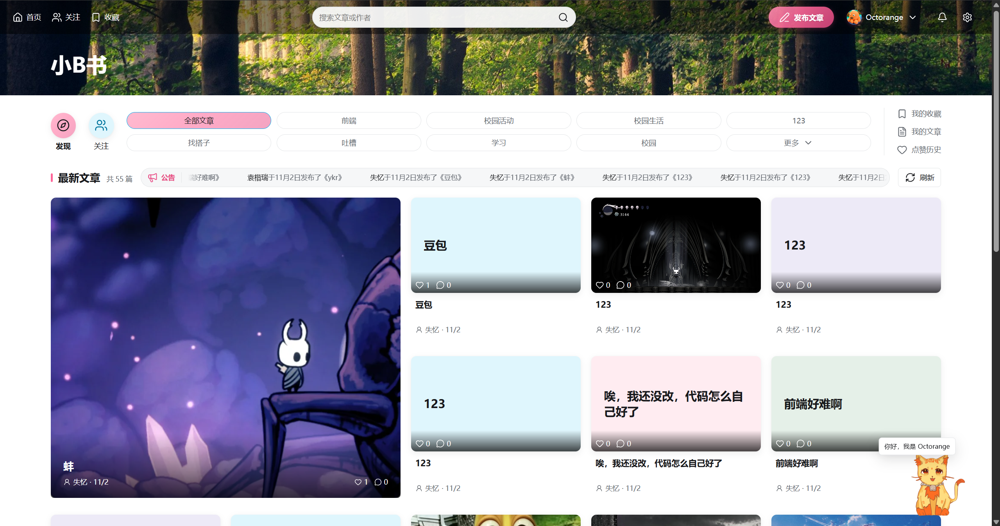](screenshots/home.png)

开发时，我尤其在意视觉效果的呈现。因此除了实现了博客的基本功能外，还接入自定义 AI 接口，并反复调整了视觉方面的内容，如：刷新区域、页面切换的平滑动画等

可维护性方面，我采用了模块化的代码结构，将不同的功能和组件分离开来，方便后续的维护和扩展

**因此，您可以重点关注以上方面的内容**

我并不打算做和商店交易方面相关的内容，因为产品定位是一个博客发布网站

## 项目特色（这里部分用 agent 总结）

### 自定义 AI 助手 Octorange

我将前两次作业中的设计的“印小灵”AI助手又迁移到了小B书（当然，经过了SFT微调），其命名为 Octorange。宠物的回复支持 Markdown 显示，且列表、代码块和表格等都能流畅阅读

登录后显示宠物，有待机、悬停和思考三种状态，且支持随意拖动，未登录时隐藏

猫耳朵上方会轮换显示白底问候气泡

用户可以点击导航栏右上角的齿轮打开设置，关闭动态问候或隐藏宠物

### 平滑动画和局部刷新

我给所有页面的切换和刷新增加了平滑过渡效果，尽量避免出现闪屏等影响视觉美观的情况

### 分栏写作、草稿和编辑保护

编辑器默认使用分栏模式（左边 Markdown，右边预览）（这是我认为最方便的编辑方式）

草稿在停止输入约 2 秒后会自动保存，开关统一放在右上角设置的“写作”分区中

如果两个页面同时修改同一篇文章，则会保留本地输入，并排展示本地和服务器内容，方便核对后决定采用哪一份

### 个人主页

我的文章和本人主页可以置顶文章（最多两篇）

个人主页可以修改头像、封面、短句、Markdown 个人介绍和外部链接，也能按月份查看文章

关注页则将同一位作者的文章放在一起，方便检索

## 界面截图

截图已按当前页面重新生成。桌面视口为 1440×960，手机视口为 440×956，表格中的预览统一高度，点击图片可以查看原图。首页和阅读画面使用本机模拟接口返回的示例文章，写作画面使用未提交的示例内容；异常画面由浏览器内的模拟接口返回错误，不会向校园服务提交数据

| 画面 | 网页端 | 手机端 |
| --- | --- | --- |
| 首页文章排列（[PNG 原图](screenshots/home.png)） | [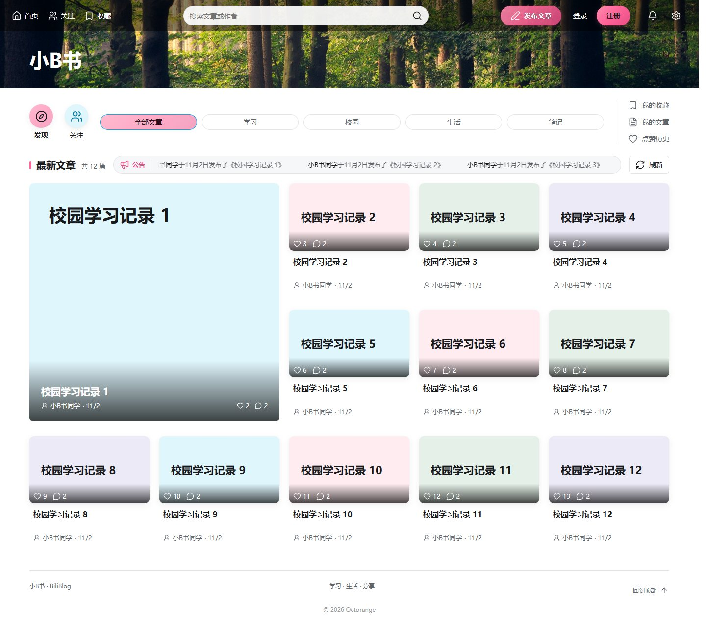](screenshots/home-desktop.jpg) | [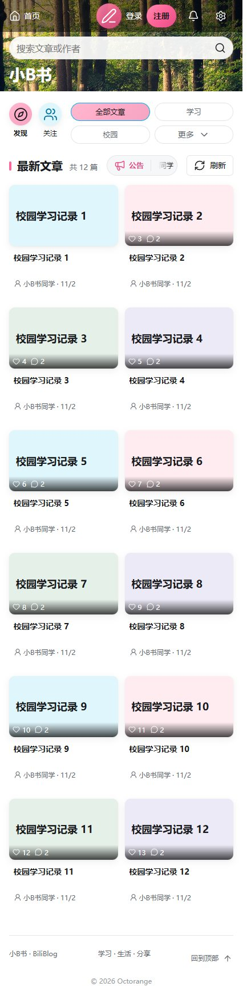](screenshots/home-mobile.jpg) |
| 文章阅读 | [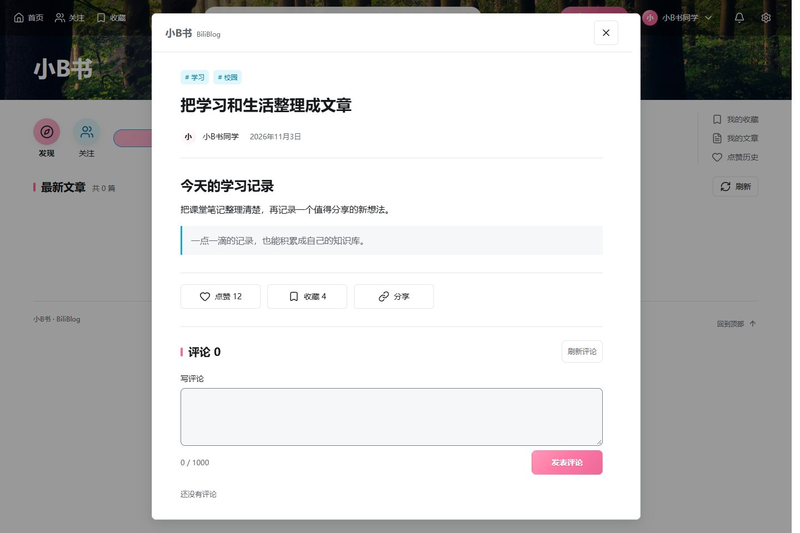](screenshots/reader-desktop.jpg) | [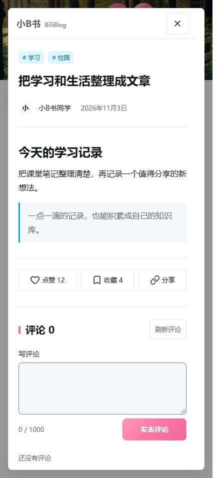](screenshots/reader-mobile.jpg) |
| Markdown 写作与预览（示例内容） | [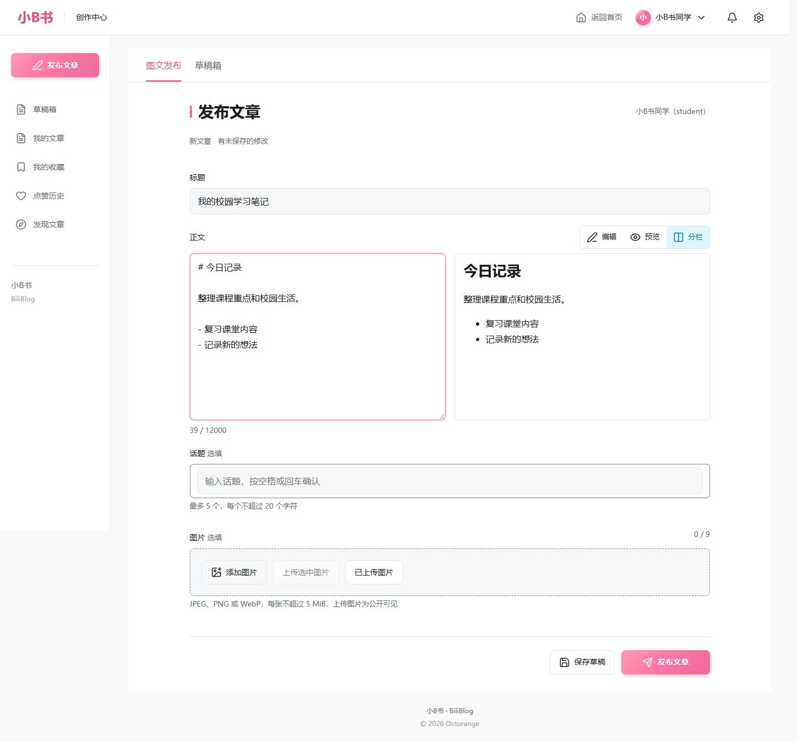](screenshots/editor-desktop.jpg) | [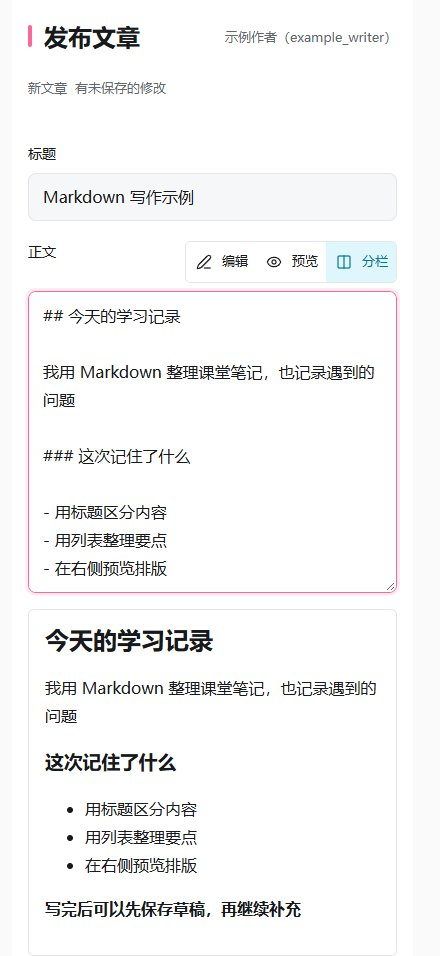](screenshots/editor-mobile.jpg) |
| 统一设置 | [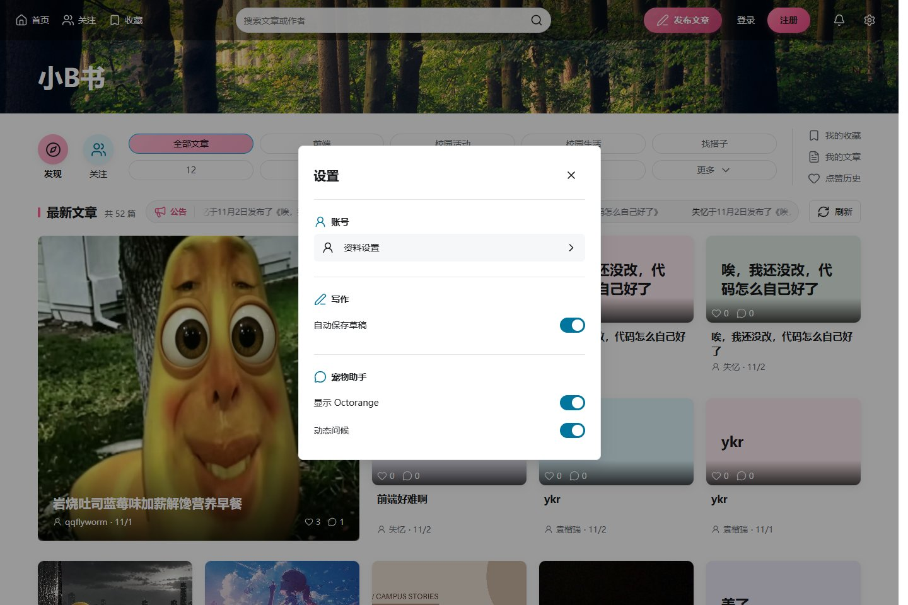](screenshots/settings-desktop.jpg) | [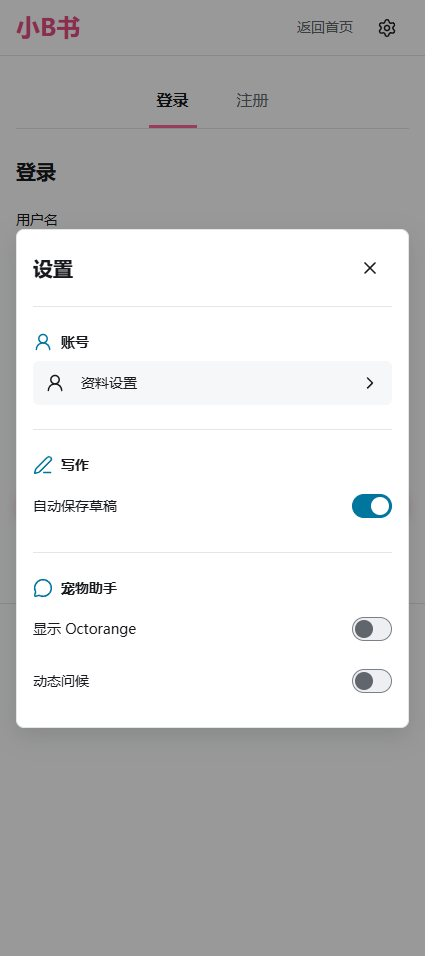](screenshots/settings-mobile.jpg) |

### 异常情况

下面通过模拟接口分别触发列表读取失败、文章不存在和登录失败，截图保留页面实际显示的提示与操作入口，演示账号和写作示例均只用于本机截图

| 触发情况 | 网页端 | 手机端 |
| --- | --- | --- |
| 列表接口返回 503，显示读取失败与刷新入口 | [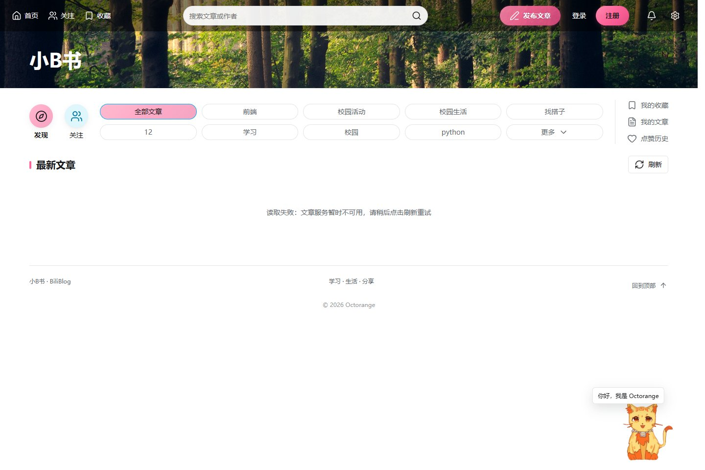](screenshots/feed-error-desktop.jpg) | [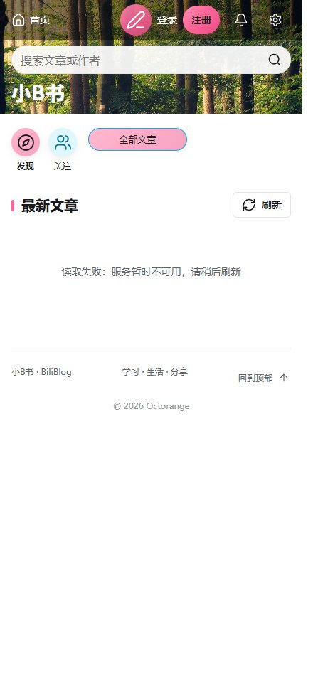](screenshots/feed-error-mobile.jpg) |
| 文章详情返回 404，显示错误与重试入口 | [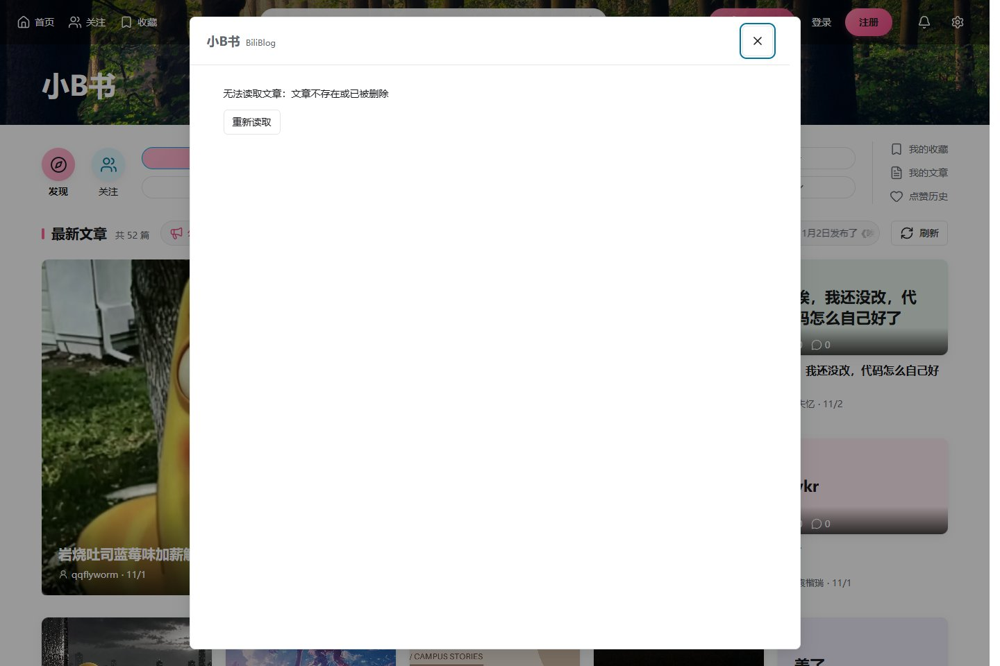](screenshots/missing-article-desktop.jpg) | [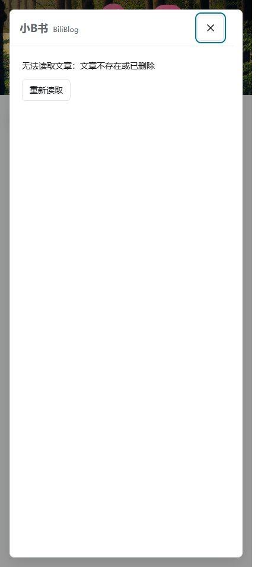](screenshots/missing-article-mobile.jpg) |
| 登录接口返回 401，显示账号或密码错误 | [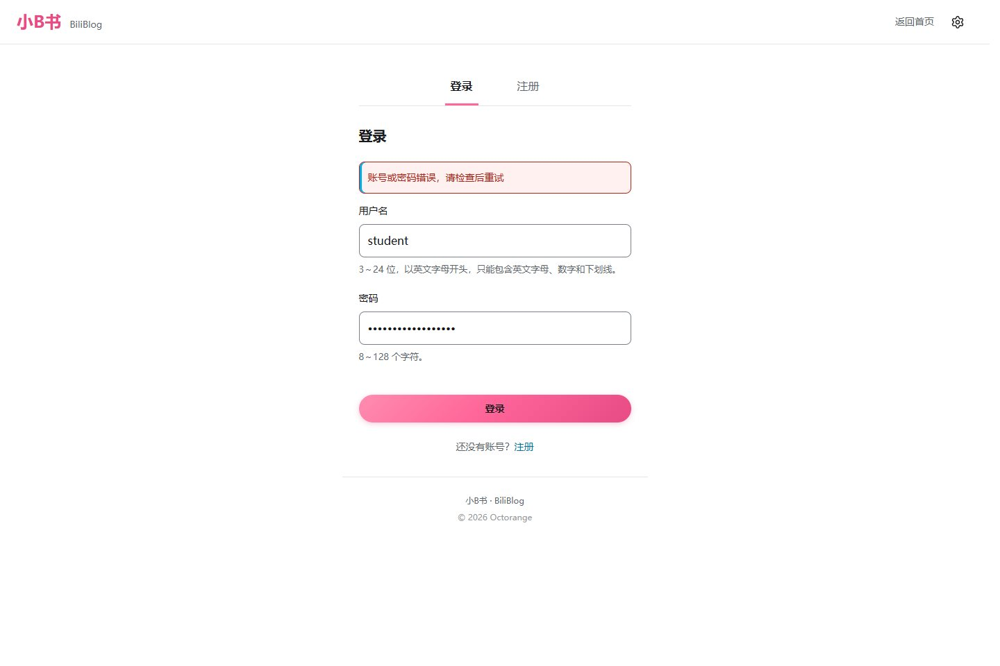](screenshots/login-error-desktop.jpg) | [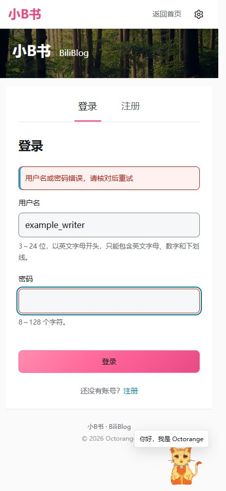](screenshots/login-error-mobile.jpg) |

## 已实现功能（这里直接用 agent 总结了）

| 模块 | 具体内容 |
| --- | --- |
| 账号 | 注册、登录、退出、当前用户展示、刷新后确认登录状态、登录失效引导 |
| 首页 | 图文列表、关键词搜索、话题筛选、作者搜索、分页、文章发布公告 |
| 阅读 | 文章详情、图片、作者信息、文章链接直接访问与刷新、本机进度恢复、复制文章链接 |
| 创作 | 新建文章、编辑已发布文章、删除本人文章，编辑时保留图片和商品关联 |
| 草稿 | 独立草稿箱、搜索、分页、继续编辑、确认删除、自动保存、本机备份恢复 |
| 编辑保护 | 按 version 保存、串行写入、版本冲突对比、保存结果未知时回读核对、离开提醒 |
| Markdown | 编辑、预览和分栏视图，解析后清理 HTML，代码块与表格可独立滚动 |
| 图片 | 本地预览、逐张上传、素材库分页、复用已上传图片、移出文章、确认删除未使用素材 |
| 互动 | 点赞与取消、收藏与取消、主评论和一级回复、分页、删除自己的评论 |
| 阅读整理 | 最多两篇置顶、收藏夹增删改与筛选、移动收藏文章、本人点赞历史 |
| 个人主页 | 公开资料与文章、头像、封面、短句、个人介绍、外部链接、月份归档 |
| 关注 | 关注与取消、粉丝数同步、按作者分组的关注文章、关注和粉丝分页名单 |
| 通知 | 未读角标、类型与阅读状态筛选、分页、单条及全部已读、本机标记未读、跳转文章或作者 |
| 宠物 AI | Octorange 文字对话、Markdown 回复、引用展示、三种角色状态、拖动、问候与显示设置 |
| 设置 | 支持设置是否自动保存草稿、宠物的显示状态等 |

未筛选的首页最新文章，第一页最多显示 22 篇，其余每页最多 20 篇；搜索、话题和私人列表每页最多 20 篇。首页会随屏幕宽度调整为 1～5 列

## 主要技术栈

| 用途 | 选择 |
| --- | --- |
| 页面和交互 | HTML5 + CSS3 + JavaScript |
| 开发与构建 | Node.js24、Vite8 |
| 后端通信 | Fetch、REST API |
| AI | 阿里云百炼应用 API，通过 Vite 服务端插件转发 |

### AI 宠物配置说明

在项目根目录按 `.env.example` 创建 `.env.local`，填写以下两项：

```dotenv
DASHSCOPE_API_KEY=请填写百炼API密钥
DASHSCOPE_APP_ID=08f487dd5e10446287bec082430afe7f // 这个应用 ID 对应本项目使用的新百炼应用
```

开发和预览服务均通过 `tools/ai-plugin.mjs` 提供 `/api/ai/chat` 与 `/api/ai/status`

## 项目结构

目录树和主要文件用途放在 [项目结构说明](project-structure.md) 中

## 本地运行与提交打包

安装 Node.js 24 后，在项目目录运行 `npm ci`，再双击 `start.cmd`，或运行 `npm run dev`，浏览器访问 `http://127.0.0.1:5173`。学校接口需要接入校园网络，AI 配置按上面的环境变量说明填写

提交前双击根目录的 [package.cmd](package.cmd)，也可以运行 `npm run package`。程序会自动执行风格与项目检查、生产构建，再把源码、素材、截图、文档、依赖清单和配置示例打包到 `submissions/`，完成后显示压缩包的完整路径，每次生成新文件

压缩包内统一放在 `BiliBlog/` 目录中，排除 `node_modules/`、`dist/`、Git 记录、本机环境变量和旧压缩包。根目录新增的 Markdown 文档，以及 `docs/` 中的代码理解材料会一同收录；打包后逐个核对文件内容，失败时自动清理临时 ZIP

路线二附加材料采用自己撰写的代码理解与开发说明，提交前应确认已完成并放入根目录或 `docs/`。在作业平台的提交说明中注明“路线二：AI Agent 开发”，并粘贴 README 的主要说明

## 注册和登录的核心代码

注册页和登录页都是用文件 [account.js](scripts/account.js)，只是通过页面的 `data-mode` 来区分是登录还是注册

### 1. 检查注册信息

```javascript
// 检查注册页的昵称和两次密码，把错误交给浏览器表单提示
function validateRegistration() {
    if (!isRegister) {
        return;
    }
    // 每次先清除旧错误，改正输入后才能继续提交
    displayName.setCustomValidity("");
    confirmPassword.setCustomValidity("");
    if (displayName.value.trim().length === 0) {
        displayName.setCustomValidity("昵称不能只包含空格");
    }
    if (password.value !== confirmPassword.value) {
        confirmPassword.setCustomValidity("两次输入的密码不一致");
    }
}
```

### 2. 提交表单（这里注册和登录用的是同一块代码）

```javascript
const credentials = {
    username: username.value,
    password: password.value
};
let path = "/auth/login";
if (isRegister) {
    path = "/auth/register";
    credentials.displayName = displayName.value.trim();
}

// 等待服务器时禁用表单，避免连续点击产生重复请求
submitting = true;
fields.disabled = true;
try {
    const session = await requestApi(path, "POST", credentials, null);
    saveSession(session);
    window.location.replace("/index.html");
} catch (error) {
    showMessage(message, error.message, true);
} finally {
    submitting = false;
    fields.disabled = false;
}
```

我让注册和登录只在请求路径与昵称字段上区分，其他步骤共用（毕竟这块几乎一模一样）

这里的 `requestApi` 使用 Fetch，把 `credentials` 转成 JSON 发送到学校后端后等待响应，之后检查 HTTP 状态后返回响应中的 `data`

### 保存凭证，让刷新后还能继续登录

保存前，[auth.js](scripts/auth.js) 会检查 `token` 是否存在，以及 `expiresAt` 是否为有效的未来时间

核心保存语句如下：

```javascript
const savedSession = {
    token: session.token,
    expiresAt: session.expiresAt
};
localStorage.setItem(SESSION_KEY, JSON.stringify(savedSession));
```

这里的 `SESSION_KEY` 来自 [config.js](scripts/config.js)，保存的内容是服务器签发的 token 和到期时间

刷新后，`readSession()` 读取这份 JSON 并检查有效期，再通过携带 `Authorization: Bearer <token>` 的请求让后端确认身份

## 首页文章排列的设计逻辑

首页布局主要在 [home.js](scripts/home.js) 和 [home.css](styles/home.css) 中实现

### 1. 网格设计

宽屏首页分成五列，左侧大图占两列、两行，右侧三列各放两篇普通文章，后面的文章继续按五列排列

考虑到第一页有一张大图文章，因此第一页文章数上限设置成 22，而后面所有页的文章数上限为 20

下面是我设计的网格和大图占位的核心样式：

```css
/* 普通桌面默认四列，每列可以随容器缩小 */
.article-grid {
    display: grid;
    grid-template-columns: repeat(4, minmax(0, 1fr));
    gap: 32px 20px;
    align-items: start;
}

/* 宽屏改为五列 */
@media (min-width: 1400px) {
    .article-grid {
        grid-template-columns: repeat(5, minmax(0, 1fr));
    }
}

/* 满足大图条件时，第一张卡片占两列和两行 */
@media (min-width: 1200px) {
    .article-grid.has-feature .article-card:first-child {
        grid-column: span 2;
        grid-row: span 2;
        align-self: stretch;
    }
}
```

### 2. 大图文章如何选择，如何避免重复

目前，只有未搜索、未筛选话题的最新文章栏目的第一页才使用大图（且当前页至少有 5 篇文章）

带图文章的选择标准是：最新的一篇带图文章。只有当当前页都是纯文字文章时，则使用最新一篇的文字封面

下面摘出 `loadFeed()` 中的核心代码片段：

```javascript
let featureIndex = 0;
if (useFeature) {
    // 优先选本页第一篇带图文章，找不到时使用第一篇
    for (let index = 0; index < result.items.length; index = index + 1) {
        if (result.items[index].images.length > 0) {
            featureIndex = index;
            break;
        }
    }
    grid.appendChild(makeCard(result.items[featureIndex], featureIndex, true));
}

// 大图已经显示过的文章跳过，其余文章保留原来的相对顺序
for (let index = 0; index < result.items.length; index = index + 1) {
    if (useFeature && index === featureIndex) {
        continue; // 跳过已经展示的大图文章，避免同一篇出现两次
    }
    grid.appendChild(makeCard(result.items[index], index));
}
grid.classList.toggle("has-feature", useFeature);
```

这里用了 `has-feature` 把脚本与样式连接起来。当脚本添加这个类后，CSS 把第一张卡片放大，其他卡片继续使用普通样式

### 3. 不同屏幕使用不同列数

我通过 F12 工具查看不同手机屏幕上画面的呈现效果，从而调整列数（当然，不是一个一个调，只是查看效果）。根据研究，一些手机上取消大图跨行、让文章按普通卡片排列的视觉效果最优

以下为实际实验数据（由 agent 总结）：
| 屏幕宽度 | 列数 | 大图排列 |
| --- | --- | --- |
| 1400px 及以上 | 5 列 | 大图占两列、两行，右侧六篇普通文章 |
| 1200～1399px | 4 列 | 大图占两列、两行，右侧四篇普通文章 |
| 768～1199px | 3 列 | 全部使用普通卡片 |
| 360～767px | 2 列 | 全部使用普通卡片 |
| 359px 及以下 | 1 列 | 全部使用普通卡片 |

## 限制刷新范围：只更新最新文章

首页“刷新”按钮绑定的是 [home.js](scripts/home.js) 中的 `loadFeed()`。

当用户点击刷新时，只需要重新请求当前列表，再替换文章网格里的节点，而导航、横幅和话题区继续使用原来的 DOM，从而实现了仅在部分区域刷新

```javascript
refreshButton.addEventListener("click", loadFeed);
```

### 1. 请求期间保留

具体而言，`feedKey` 由当前列表的接口路径和登录凭证组成，路径中包含搜索、话题和页码等条件。同一个列表刷新时保留卡片，切换条件时再按原流程显示占位，核心代码如下：

```javascript
const feedKey = feedPath() + "|" + token;
const keepCards = keepFavorites || (displayedFeedKey === feedKey && grid.hasChildNodes());
grid.setAttribute("aria-busy", "true");
grid.inert = true;
if (!keepCards) {
    pagination.hidden = true;
    displayedFeedKey = "";
    displayedFavoritesToken = null;
    grid.replaceChildren();
}
```

### 2. 区域刷新实现方式

由于网络请求可能交错返回，因此 agent 选择在每次读取开始时先增加请求编号，返回后再核对编号和账号。下面三段分别摘自请求开始、收到结果和结束清理的位置，列表排版继续使用上一节的大图选择与卡片生成逻辑

```javascript
feedRequest = feedRequest + 1;
const requestNumber = feedRequest;
```

```javascript
const result = await requestFeed();
const activeToken = currentToken();
const becameGuest = feed === "latest" && !activeToken;
if (requestNumber !== feedRequest || (activeToken !== token && !becameGuest)) {
    return;
}

// 新响应属于当前列表时，再清空旧卡片并按本页数据生成新卡片
grid.replaceChildren();
```

```javascript
// 这段位于 finally 中，最新请求结束后恢复列表和分页交互
if (requestNumber === feedRequest) {
    refreshButton.disabled = false;
    setBusy(refreshButton, false);
    grid.setAttribute("aria-busy", "false");
    grid.inert = false;
    pagination.inert = false;
}
```

## 平滑动画：标签展开与收起

标签展开由 [home.js](scripts/home.js) 改变可见项，动画则由 [motion.js](scripts/motion.js) 的 `resizePanel()` 实现

### 1. 计算目标状态

```javascript
// 切换展开状态，再由共用函数播放容器高度的过渡
function toggleTopics() {
    const expanded = moreTopics.getAttribute("aria-expanded") !== "true";
    // 具名回调只负责改变标签状态，测量与动画交给 resizePanel
    resizePanel(topicList, function changeTopicVisibility() {
        moreTopics.setAttribute("aria-expanded", String(expanded));
        updateTopicVisibility();
    });
}
```

`updateTopicVisibility()` 根据屏幕宽度、展开状态隐藏或显示标签，小屏幕手机默认保留三个标签和“更多”。这里保留原来的按钮和箭头节点，改文字时只更新文字节点，所以箭头可以从当前角度继续旋转

### 2. 从当前高度过渡到目标高度

直接隐藏或显示标签会让容器高度瞬间变化。`resizePanel()` 先量出当前高度，更新内容后再量出目标高度，然后把这两个数作为动画的起点和终点，下面摘出它的测量和播放步骤

```javascript
const startHeight = element.getBoundingClientRect().height;
const previous = panelChanges.get(element);
if (previous) {
    // 连续点击时取消上一轮结束处理，新的动画从当前高度继续
    element.removeEventListener("transitionend", previous.finish);
    window.clearTimeout(previous.timer);
}
element.classList.remove("is-resizing");
element.style.removeProperty("height");
updateContent();
const endHeight = element.getBoundingClientRect().height;
```

```javascript
// 起点先写入像素高度，让浏览器记录这一帧的布局
element.style.height = startHeight + "px";
void element.offsetHeight;
element.classList.add("is-resizing");
element.addEventListener("transitionend", finishResize);
element.style.height = endHeight + "px";
```

`void element.offsetHeight` 会先读取一次布局，让浏览器先确认起点，再处理目标高度

动画结束后，`finishResize()` 移除固定高度和过渡类，容器恢复自然排版，并清理监听器

### 3. 高度与箭头分别过渡

下面的参数来自 [tokens.css](styles/tokens.css)，高度过渡维护在 [feedback.css](styles/feedback.css)，箭头旋转维护在 [home.css](styles/home.css)

```css
:root {
    /* 标签展开时长为 200ms，整个过程先快后慢 */
    --duration-panel: 200ms;
    --ease-out: cubic-bezier(0.23, 1, 0.32, 1);
}

/* 只在过渡期间固定高度并裁掉溢出的内容 */
.is-resizing {
    overflow: clip;
    transition: height var(--duration-panel) var(--ease-out);
}

/* 保留同一个箭头节点，展开时旋转，收起时转回 */
.more-topics svg {
    transition: transform var(--duration-panel) var(--ease-out);
}
.more-topics[aria-expanded="true"] svg {
    transform: rotate(180deg);
}
```

这段代码调整了标签容器的高度和箭头角度，使文章区随容器的实际高度连续移动

结束后恢复自然高度，后续切换手机、桌面宽度时仍能重新排版

## 后续安排

| 项目 | 当前情况与后续处理 |
| --- | --- |
| 校园网络 | 学校接口依赖校园网络 |
| AI 部署 | 静态页面配套部署 AI 转发接口，密钥保存在服务端环境中 |
| 模拟商铺 | 未来暂时不考虑接入 |
| 其他扩展 | 后续可能考虑设计深色模式（由于担心太丑就先没做） |

## AI 使用说明

我使用 AI Agent 协助拆解需求、编写部分代码、分析报错和检查页面，并根据实际操作提出修改

阅读窗口的加载尺寸、评论刷新范围、平滑动画设计等是我在开发中逐步核对和调整的内容
